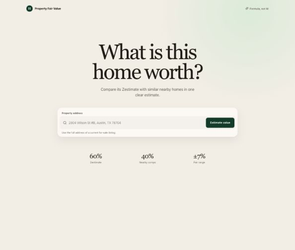

# Property Fair Value

A minimal React demo that estimates the fair value of a US for-sale property using its Zestimate and nearby comparable homes from [ZillAPI](https://zillapi.com).



## What it demonstrates

Enter a full US listing address to see the property, asking price, calculated fair value, fair range, verdict, confidence, comparable homes, and a visual comparison of the asking price, Zestimate, and comp value.

The calculation is intentionally transparent and uses no AI at runtime:

1. Keep nearby homes with the same property type and 70–130% of the subject's square footage.
2. Calculate the median comparable price per square foot.
3. **Comp value** = median comp price per square foot × subject square footage.
4. **Fair value** = 60% Zestimate + 40% comp value.
5. **Fair range** = fair value ±7%.
6. Label the asking price **Fair**, **Below**, or **Above** that range.

The included sample address is `2804 Wilson St #B, Austin, TX 78704`.

## Run locally

You need Node.js 20 or newer and a [ZillAPI](https://zillapi.com) API key.

```bash
npm install
cp .env.example .env
```

Add your key to `.env`, then start the app:

```bash
set -a; source .env; set +a
npm run dev
```

Open [http://127.0.0.1:5173](http://127.0.0.1:5173).

## Verify

```bash
npm test
npm run build
```

## How it works

The browser calls the local Express server. The server keeps the ZillAPI key private, retrieves the subject property with `property-by-address`, loads nearby properties, and returns the deterministic valuation. The key is never sent to the browser.

## Demo disclaimer

This repository is an independent demonstration of a possible ZillAPI integration. It is not an appraisal, financial advice, or investment advice, and it is not affiliated with or endorsed by Zillow. Property data and estimates can be incomplete, delayed, or inaccurate; verify important decisions with qualified professionals and primary records.

## License

[MIT](LICENSE)
